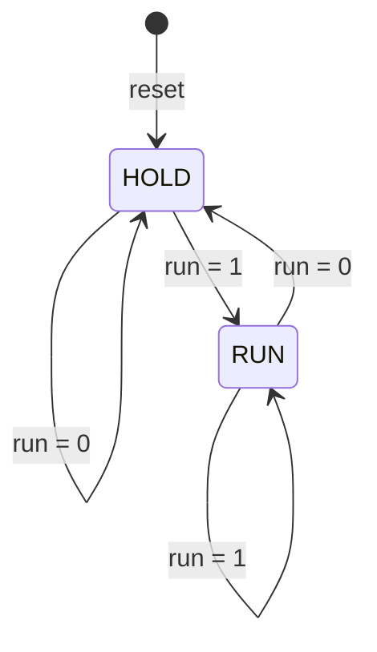

# 4-Bit Counter FSM with Run/Hold Control and 7-Segment Output

DLCD Level-2 – Problem A

A 4-bit counter controlled by a 2-state Moore FSM (`RUN` / `HOLD`), with its value shown on a common-cathode 7-segment display (hex digits `0`–`F`). Written in Verilog and verified with a self-checking testbench.

**Team:** `<Team name / number>`
**Members:** `<Name 1>`, `<Name 2>`, `<Name 3>`, `<Name 4>`
**Section / Lab instructor:** `<Section>` / `<Instructor>`

---

## 1. Interface

| Signal      | Dir | Width | Description                                        |
|-------------|-----|-------|----------------------------------------------------|
| `clk`       | in  | 1     | Clock, rising-edge active                          |
| `reset`     | in  | 1     | Synchronous, active high (clears count, goes to HOLD) |
| `run`       | in  | 1     | `1` = count up, `0` = hold                         |
| `count[3:0]`| out | 4     | Current counter value                              |
| `seg[6:0]`  | out | 7     | 7-segment pattern, active high, `seg = {g,f,e,d,c,b,a}` |

## 2. Behaviour

- `run = 1` → FSM is in **RUN**, `count` increases by 1 every clock edge and wraps `1111 → 0000`.
- `run = 0` → FSM is in **HOLD**, `count` keeps its value.
- `seg` is generated combinationally from `count`.

## 3. State diagram (Task 1)



Moore FSM: the state depends only on `run` at the previous clock edge. Every arrow, including both self-loops, is labelled with its transition condition.

## 4. Next-count logic (Task 2)

| State | `run` | next `count`         |
|-------|-------|----------------------|
| RUN   | 1     | `(count + 1) mod 16` |
| HOLD  | 0     | `count`              |

A 2-to-1 MUX, controlled by `run`, selects between `count + 1` and `count`. Its output feeds the D inputs of four flip-flops.

```
              +-----------+
 count + 1 -->| 1         |
              |   2:1 MUX |--> D[3:0] --> [ 4 x D-FF ] --> count[3:0]
 count -----> | 0         |                    ^   |
              +-----^-----+                    |   |
                    |                         clk  +--> (feeds back to MUX and incrementer)
                   run
```

In `counter_fsm.v` the MUX is `assign next_count = (next_state == RUN) ? count_inc : count;`.

## 5. 7-segment decoder truth table (Task 3)

`seg = {g,f,e,d,c,b,a}`, common cathode, active high.

| Hex | `count[3:0]` | `seg[6:0]` (gfedcba) | Hex value |
|-----|--------------|----------------------|-----------|
| 0   | 0000 | 0111111 | 3F |
| 1   | 0001 | 0000110 | 06 |
| 2   | 0010 | 1011011 | 5B |
| 3   | 0011 | 1001111 | 4F |
| 4   | 0100 | 1100110 | 66 |
| 5   | 0101 | 1101101 | 6D |
| 6   | 0110 | 1111101 | 7D |
| 7   | 0111 | 0000111 | 07 |
| 8   | 1000 | 1111111 | 7F |
| 9   | 1001 | 1101111 | 6F |
| A   | 1010 | 1110111 | 77 |
| b   | 1011 | 1111100 | 7C |
| C   | 1100 | 0111001 | 39 |
| d   | 1101 | 1011110 | 5E |
| E   | 1110 | 1111001 | 79 |
| F   | 1111 | 1110001 | 71 |

## 6. Repository structure

```
.
├── README.md
├── src/
│   ├── counter_fsm.v          # 2-state Moore FSM + 4-bit counter
│   ├── seg_decoder.v          # combinational hex -> 7-segment decoder
│   └── top_counter_7seg.v     # top level: counter_fsm + seg_decoder
├── tb/
│   └── tb_top_counter_7seg.v  # self-checking testbench
├── sim/
│   ├── counter.vcd            # waveform dump from the testbench
│   └── waveform.png           # (optional) GTKWave screenshot
└── docs/
    └── DLCD-LEVEL-2-PROBLEM_A.pdf   # problem statement
```

## 7. How to run

Requires [Icarus Verilog](https://steveicarus.github.io/iverilog/) and (optionally) GTKWave.

```bash
# compile
iverilog -o sim_out src/counter_fsm.v src/seg_decoder.v src/top_counter_7seg.v tb/tb_top_counter_7seg.v

# run (writes counter.vcd in the current directory)
vvp sim_out

# view waveforms
gtkwave counter.vcd
```

## 8. Testbench (Task 4)

`tb_top_counter_7seg.v` is self-checking and prints `PASS` / `FAIL` messages, ending with `ALL TESTS PASSED` or `TESTS FAILED: <n> errors`. It checks:

1. **Count increases while `run = 1`**: runs 20 clocks, checking `count == prev + 1` every cycle.
2. **Wrap-around**: detects `1111 → 0000` during the run above and prints `PASS: wrap 1111 -> 0000`.
3. **Count holds while `run = 0`**: `count` must stay constant for 6 clocks.
4. **Synchronous reset**: `count` returns to `0000` when `reset = 1`.
5. **Decoder correctness**: on every change of `count` or `seg`, `seg` is compared against an expected 16-entry table.

## 9. Files / tools

- Language: Verilog (IEEE 1364)
- Simulator: Icarus Verilog
- Waveform viewer: GTKWave

## 10. Sample output

Paste your own simulation console output here (from `vvp sim_out`) and the GTKWave screenshot (`sim/waveform.png`):

```
<paste output here>
```
